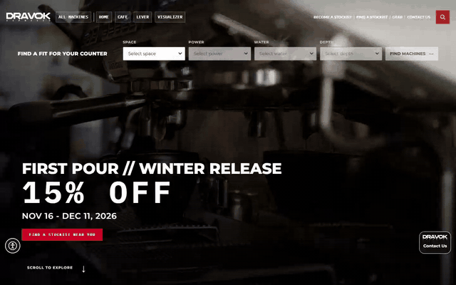

# Dravok Espresso

Website katalog untuk **Dravok**, merek fiktif mesin espresso rumahan, kafe, dan tuas manual. Pengunjung menelusuri mesin, mengecek apakah mesin cocok dengan meja mereka (ruang, listrik, air, kedalaman), memilih konfigurasi, membandingkan, lalu mencari stockist. Tidak ada keranjang belanja: konsepnya katalog plus pencari toko. Ini rebuild orisinal yang terinspirasi tampilan dan perilaku sebuah situs katalog otomotif; merek, produk, teks, gambar, logo, dan kode di sini dibuat baru.

## Halaman

| File | Isi |
|---|---|
| `index.html` | Hero video, pencari meja, showcase 4 mesin yang ter-pin saat scroll, accordion 3 lini |
| `all-machines.html` | 32 mesin, filter, sortir, load more |
| `home.html`, `cafe.html`, `lever.html` | Koleksi per lini (`home.html` = lini Home, bukan beranda) |
| `new-arrivals.html`, `color-series.html` | Koleksi gaya baru dan finish berwarna |
| `products/*.html` (32) | Detail mesin: galeri, zoom, konfigurator, tabel spesifikasi, rekomendasi |
| `visualizer.html` | Pilih meja, lalu letakkan dan geser mesin di atas foto dapur |
| `stockists.html` | Daftar 16 stockist fiktif dan peta SVG yang bisa digeser/zoom |
| `become-a-stockist.html`, `contact.html` | Formulir dengan validasi (demo, tidak mengirim data) |
| `faq.html` | 12 pertanyaan dalam 4 grup |
| `search.html` | Hasil pencarian dengan 5 filter |
| `gear.html` | 4 aksesori |
| `warranty.html`, `water-safety.html`, `accessibility.html` | Halaman teks |
| `404.html` | Halaman tidak ditemukan |

## Fitur dan interaksi

- Hero: video zoom dan menggelap saat scroll, lalu panel "shutter" membuka showcase; mesin, kata outline, dan cincin rotor bergerak mengikuti scroll. Tab bisa diklik atau pakai panah kiri/kanan.
- Accordion 3 panel melebar (desktop) atau memanjang (mobile).
- Pencari meja bertingkat; pilihan disimpan dan dipakai untuk status **Direct Fit / Needs Review** di seluruh situs.
- My Bar, Saved setups, dan Compare (maks. 4 mesin) di `localStorage`.
- Pencarian instan, laci filter, menu mobile, dialog setup, zoom galeri, dialog support (jawaban tertulis, bukan AI), panel aksesibilitas, banner cookie.
- Menghormati `prefers-reduced-motion`. Tidak ada sound (referensi juga tidak memakainya).
- Diuji di 1440 px dan 390 px.

## Teknologi

HTML, CSS, dan JavaScript native. Tanpa framework, build step, atau server. Font lokal: Montserrat, IBM Plex Mono, Oxanium, Sarpanch (family yang sama dengan situs inspirasi).

## Menjalankan

Buka `index.html` di browser. Semua path relatif, jadi berjalan dari `file://`. Di beberapa browser, `localStorage` pada `file://` terbatas; situs tetap jalan, hanya pilihan tidak tersimpan. Tambahkan `?nocookie` di URL untuk menyembunyikan banner cookie.

## Struktur

```
.
├── index.html, all-machines.html, home.html, cafe.html, lever.html
├── new-arrivals.html, color-series.html, visualizer.html, stockists.html
├── become-a-stockist.html, contact.html, faq.html, search.html, gear.html
├── warranty.html, water-safety.html, accessibility.html, 404.html
├── products/            32 halaman detail mesin
├── css/                 main.css (token, header, footer, dialog, kartu), home.css, shop.css, pages.css
├── js/                  data.js, main.js, home.js, shop.js, product.js, search.js, stockists.js, visualizer.js
├── assets/
│   ├── img/             foto produk (p-*), angle (a-*), detail-*, life-*, line-*, hero
│   │   └── cut/         32 cutout transparan (.webp) untuk showcase dan visualizer
│   ├── video/           hero.mp4, hero-mobile.mp4
│   └── fonts/           woff2
└── docs/preview/        homepage.gif, hero.png
```

## Mengedit

Tidak ada generator. Edit langsung file akhirnya.

- **Teks:** di file HTML. Header, footer, dan dialog ada di setiap halaman, jadi gunakan cari-ganti di seluruh folder.
- **Warna dan font:** variabel `:root` di `css/main.css` (`--red`, `--red-hot`, `--head`, `--body`, `--foot`).
- **Harga, boiler, voltase, part number:** `js/data.js` (pencarian, compare, konfigurator) **dan** tabel serta harga di `products/<id>.html`. Keduanya harus sama.
- **Pilihan meja dan aturan cocok:** `OPT` dan `fit()` di `js/main.js`.
- **Stockist:** array `S` di `js/stockists.js` (nama, alamat, lintang, bujur).
- **Foto produk:** ganti `assets/img/p-<id>.jpg` (persegi, latar putih) dan `assets/img/cut/<id>.webp` (transparan) dengan nama yang sama.
- **Video hero:** `assets/video/` dan poster `assets/img/hero-poster.jpg`, `mhero-1.jpg`.

## Perlu diganti sebelum dipakai

- Merek Dravok dan Dravok Works, logo (SVG inline), favicon, tagline. Belum dicek ke basis data merek dagang.
- Promo hero (15% OFF, 16 Nov–11 Des 2026).
- Tautan media sosial (`#`), seluruh stockist dan alamatnya (fiktif).
- Harga, spesifikasi, teks garansi, dan teks keselamatan (karangan, bukan teks hukum).
- Formulir: hubungkan ke layanan Anda di bagian `form[data-form]` pada `js/main.js`.

## Kredit aset

- **Gambar produk, gaya hidup, detail, dan lini:** dihasilkan AI (Nano Banana via Google Flow). Cutout dibuat otomatis dari gambar tersebut.
- **Video hero dan posternya:** potongan klip Mixkit nomor 41228, 3578, 3572 (Mixkit Stock Video Free License), dipotong dan dikoreksi warna.
- **Font:** Google Fonts (SIL Open Font License).
- **Peta:** Natural Earth via world-atlas (domain publik).

## Keterbatasan

- Mesin adalah konsep visual AI. Detail antar finish dari satu gaya bisa sedikit berbeda, dan hanya Halcyon serta Bastion (Gloss Black) yang punya foto angle tambahan. Foto detail dan suasana dipakai bersama oleh beberapa produk.
- Isi visualizer setelah memilih meja dirancang sendiri karena tampilan aslinya tidak bisa direkam.
- Peta, captcha, dan asisten AI pada situs inspirasi adalah layanan pihak ketiga; di sini diganti peta SVG sendiri, tanpa captcha, dan jawaban tertulis.
- Jumlah produk 32 (situs inspirasi menampilkan 38–42), sehingga tinggi beberapa halaman tidak persis sama.
